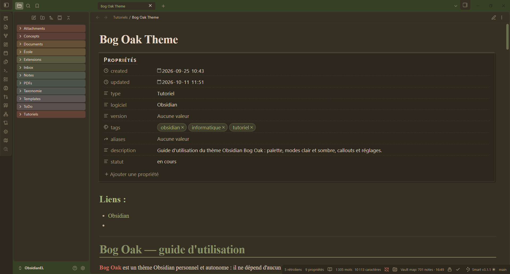
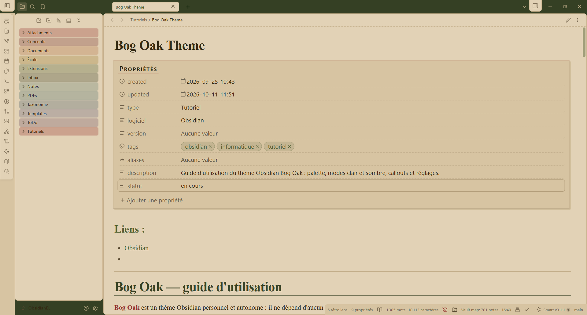
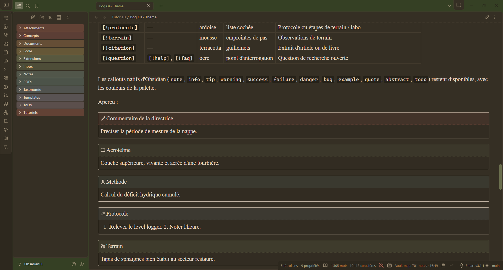
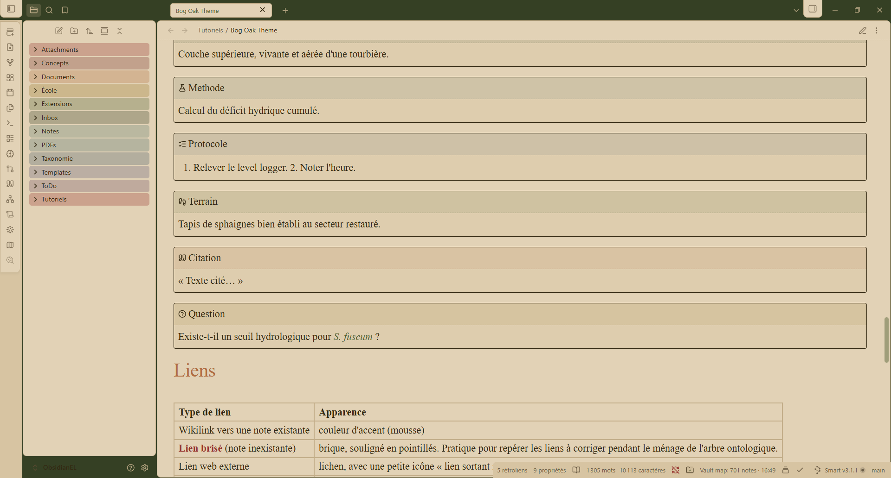

# Bog Oak

An earthy, "dark academia" theme for [Obsidian](https://obsidian.md): old paper in light mode, walnut brown in dark mode, moss-green accents and a Kombu-green window frame.

Bog oak is wood that has lain for centuries in a peat bog, slowly darkening into a deep brown. This theme borrows that palette: peat, moss, lichen, ochre and brick.

| Dark mode | Light mode |
|---|---|
|  |  |
|  |  |

## Features

- **Standalone:** no dependency on Style Settings or any other plugin. Every option is built into the CSS.
- **Two modes:** light mode in old yellowed paper (`#E4D3B4`) with *Café Noir* ink; dark mode in walnut brown (`#362F23`) with *Bone* text.
- **Card layout** with shadows, animated **Safari-style tabs**, colorful window frame.
- **Earthy rainbow folders** in the file explorer.
- **Colored headings** (H1 to H6) and a divider under H1.
- **Tinted tag pills**, with optional color families (see below).
- **Custom callouts** for research notes: `correction`, `definition`, `methode`, `protocole`, `terrain`, `citation`, `question`.
- **Links:** unresolved links in brick with a dotted underline (easy to spot), external links in lichen with a small icon, Zotero links (`zotero://`) in terracotta with a book icon.
- **Properties** styled like a library index card.
- **Syntax highlighting** drawn from the palette.
- **Scrollbars** in moss green, slightly wider than Obsidian's.

## Installation

Until the theme is listed in Obsidian's community themes:

1. Create a folder named `Bog Oak` in `<your vault>/.obsidian/themes/`.
2. Copy `theme.css` and `manifest.json` into it.
3. In Obsidian, open **Settings → Appearance → Themes** and select **Bog Oak**.

## Palette

The CSS keeps the Catppuccin color names inherited from AnuPpuccin (`--ctp-…`).

| CSS name | Color | Light mode | Dark mode |
|---|---|---|---|
| `red` | brick | `#9B3B2A` | `#D0735A` |
| `maroon` | burgundy | `#7A3328` | `#B8645A` |
| `peach` | terracotta | `#B5703A` | `#D9975A` |
| `yellow` | ochre | `#9A7A1E` | `#D9B55C` |
| `green` | moss (main accent) | `#4F5E2E` | `#A9B77A` |
| `teal` | kombu / moss | `#354022` | `#899264` |
| `sky` | sage | `#5B7A6E` | `#8FB0A2` |
| `sapphire` | lichen | `#4A6B6B` | `#7FA3A0` |
| `blue` | slate | `#445A68` | `#8DA2B0` |
| `mauve` | plum | `#6E4F63` | `#B39AAB` |
| `base` | note background | `#E4D3B4` (old paper) | `#362F23` (walnut) |
| `text` | text | `#33280F` | `#E9D8C4` (Bone) |

## Customization

There is no settings panel: edit `theme.css` directly. Obsidian reloads the theme as soon as the file is saved.

- **`BOG OAK: CUSTOMIZATION`** (near the end of the file) holds every value: general settings in `body { … }`, colors in `body.theme-light { … }` and `body.theme-dark { … }`. Colors are RGB triplets, e.g. `--ctp-custom-base: 228, 211, 180;`.
- **`MY VAULT TAGS`** (end of the file) gives a color to families of tags. It is written for the author's vault: adapt it to your own tags or delete it (tags not listed get the accent color). To color a tag, add its selectors to a family:

  ```css
  a.tag[href="#mytag" i],
  a.tag[href^="#mytag/" i],
  .cm-hashtag.cm-tag-mytag
  ```

Useful variables:

| Variable | Role | Default |
|---|---|---|
| `--anp-editor-font-lp` / `--anp-editor-font-rv` | Font in live preview / reading view | `"Times New Roman", Times, serif` |
| `--file-line-width` | Maximum line width | `700px` |
| `--anp-rainbow-folder-bg-opacity` | Strength of folder colors | `0.3` |
| `--anp-card-radius` | Card corner radius | `8px` |
| `--tag-radius` | Tag pill radius | `2em` |
| `--bo-scrollbar-width` | Scrollbar width | `14px` |

## Credits

Bog Oak is derived from **[AnuPpuccin](https://github.com/AnubisNekhet/AnuPpuccin) 1.5.0 by Anubis**, itself based on the [Catppuccin](https://github.com/catppuccin/catppuccin) palette system. The selected AnuPpuccin options were made permanent, the palette was replaced, and new styles (tags, callouts, links, properties, scrollbars) were added. AnuPpuccin's copyright and license notice are kept at the top of `theme.css`.

If you like this theme, please consider supporting the original author: [Buy Me a Coffee (Anubis)](https://www.buymeacoffee.com/anubisnekhet).

## License

[GPL-3.0](LICENSE), like AnuPpuccin.
